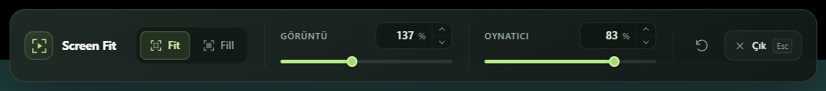

# Screen Fit

**Windowed fullscreen for browser videos.** Keep your tabs and address bar visible while video fills the current tab.

[Türkçe](README.tr.md) · [Changelog](CHANGELOG.md) · [Privacy](PRIVACY.md)



## Features

- One-click expansion and restore, with Esc and keyboard shortcuts.
- Smart, manual, or largest-video selection.
- Fit / Fill, independent **image zoom (25–300%)** and **player size (25–100%)**.
- Floating toolbar with custom sliders and percentage steppers; hides automatically when idle.
- Turkish and English interfaces, with a saved language selector in Options.
- Compatibility guidance for missing, off-screen, custom, or disabled embedded players. Retry and settings actions are available on the page.
- Optional access to selected embedded-player origins for image scaling and Esc inside cross-origin frames.
- No accounts, telemetry, external APIs, or runtime server.

## Install

This project is an **unpacked Manifest V3 extension**, not a Chrome Web Store listing.

1. Download the Chrome ZIP from [Releases](https://github.com/ibrahimemiraydin/screen-fit/releases), or build it with the commands below.
2. Extract the ZIP.
3. Open your browser's extensions page and enable **Developer mode**.
4. Select **Load unpacked** and choose the extracted folder containing `manifest.json`. For a local build, use `.output/chrome-mv3`.
5. Pin Screen Fit, open a video page, and click the extension icon.

After updating, reload the unpacked extension and refresh open video tabs. Previous browser error entries can be cleared separately.

## Use

Click the icon again, press Esc, or use Exit to restore the page. Move the pointer to the top edge of the tab to reveal controls over an embedded player.

| Control | Behavior |
| --- | --- |
| Fit / Fill | Preserve the aspect ratio; show the whole image or crop to fill. |
| Image | Zoom content without enlarging player controls. |
| Player | Resize and center the player within the tab. |
| Reset icon | Restore both percentages to 100%. |
| `Alt+Shift+F` | Expand / restore. |
| `Alt+Shift+V` | Start selection; a single suitable player may open directly. |

Change shortcuts in the browser extension-shortcut settings. Options holds selection, language, default scales, outlines, notifications, and embedded-player preferences. Toolbar changes apply to the current session; Options values are defaults for future sessions.

When needed, **Enable player access** opens a page listing the exact origins being requested. Approval is optional and can be revoked through the browser's extension site-access settings. Player-size adjustment and Exit remain available without approval.

## Compatibility

Standard HTML5 video, YouTube-style player containers, open Shadow DOM, same-origin frames, and suitable embedded-player frames are targeted. Some custom canvas players have explicit adapters. Video elements are not moved or cloned; scaling does not change their source or restart playback.

Compatibility is not guaranteed on every site. A custom-player message is a heuristic, not a definitive diagnosis. Closed Shadow DOM, protected browser pages, DRM, advertising transitions, nested frame restrictions, and custom rendering can limit support. Optional iframe access does not guarantee control of every internal rendering layer. Image zoom requires CSS `object-view-box` support.

## Privacy and permissions

| Permission | Purpose |
| --- | --- |
| `activeTab` | Temporary access to the tab invoked by the user. |
| `scripting` | Inject the video controller when requested. |
| `storage` | Save local preferences and temporary frame-session state. |
| `webNavigation` | Find the selected player's frame IDs and descendants. |
| Optional HTTP / HTTPS origins | Requested only for selected eligible player origins, after user review. |

There are no mandatory host permissions or automatically registered production content scripts. Settings stay in `storage.local`. Frame IDs, origin patterns, display values, and a random session key temporarily use `storage.session` and are removed on exit or tab/navigation cleanup. Viewing history and full media URLs are not stored. Compatibility hints stay on the page and are not sent anywhere.

## Development

Use Node.js 24 and npm.

```sh
npm ci
npm run dev
npm run check
npm test
npm run build
npm run test:e2e
npm run zip
```

Browser tests use installed Edge on Windows by default. Set `SCREEN_FIT_BROWSER_PATH` to use another installed Chromium executable. The fixture server starts automatically. Test-only host grants apply to temporary extension copies, not the shipped manifest.

Coverage includes selection, settings, language changes, media-source preservation, pixel-based zoom checks, keyboard exit across frames, relay cleanup, compatibility cards, custom steppers, and responsive layout. Native permission approval and real toolbar-click / activeTab grants remain manual checks. Live sites and different browser variants need their own validation.

`node scripts/probe-youtube.mjs --scales` is an optional live smoke test using a public sample video in a fresh unsigned-in browser. Generated captures, diagnostics, profiles, builds, and publication helpers are excluded from Git.

## License

**UNLICENSED.** This repository is publicly viewable; no open-source license has been selected. Dependencies retain their respective licenses.
